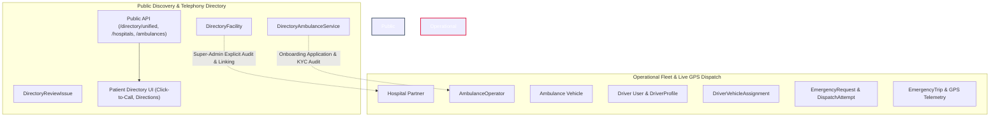

# LifeLink Architecture Manifesto: Public Directory vs. Live Dispatch Fleet

**Document Version:** 1.0.0  
**Effective Date:** 2026-10-27  
**Status:** Mandatory Architectural Constraint & Compliance Guideline  
**Applicability:** Backend Data Layer, API Gateways, Dispatch Logic, Frontend UI

---

## 1. Core Architectural Principle: Absolute Separation

> **Non-Negotiable Rule:**  
> A public directory record must **NEVER** automatically become a dispatch-eligible driver, vehicle, or organization.  
> Under no circumstances may public business listings be hallucinated into active GPS responders or fake driver accounts.

LifeLink maintains two fundamentally distinct architectural domains:



---

## 2. Data Model & Domain Separation

| Attribute / Capability | Domain A: Public Directory | Domain B: Operational Live Fleet |
| :--- | :--- | :--- |
| **Primary Models** | `DirectoryFacility`, `DirectoryAmbulanceService` | `Hospital`, `AmbulanceOperator`, `Ambulance`, `DriverProfile` |
| **Primary Use Case** | Citizen information discovery, click-to-call, directions | Real-time automated algorithmic emergency dispatch |
| **Identity & Auth** | Publicly listed business phone, website, official URL | Authenticated User accounts (`bcrypt` password hash, JWT/cookies, RBAC) |
| **Driver Accounts** | **Zero drivers.** Never generated or scraped | Verified individuals with driving license and background verification |
| **Vehicles** | Informational fleet description text (e.g. "BLS & ICU") | Registered chassis number, RTO plate number, fitness certificate |
| **GPS Telemetry** | Static rooftop or locality coordinates for mapping | Live WebSocket GPS telemetry packets (`speedKmH`, `timestamp`) |
| **Dispatch Eligibility** | **Strictly Ineligible.** Excluded from dispatch queries | Evaluated per second (`isDispatchEligible`, `AVAILABLE`, in service area) |
| **Emergency Fallback** | Fallback contact displayed (108, 112) | Automatic escalation; fallback if no active driver accepts |

---

## 3. Strict Security & Anti-Hallucination Gates

### 3.1 Prohibition of Synthetic Drivers
- **Zero Scraped Personal Numbers:** Personal mobile numbers of drivers are never scraped from business aggregators.
- **Onboarding Consent:** Drivers must independently register via `/api/v1/auth/register/driver`, submit government driving licenses and commercial badges, and consent to real-time GPS tracking.
- **Assignment Required:** A driver cannot receive offers unless actively assigned to an inspected vehicle via `DriverVehicleAssignment`.

### 3.2 Dispatch Engine Query Integrity
When an emergency SOS is triggered by a patient:
```typescript
// backend/src/services/dispatchEngine.ts
// 1. Queries ONLY operational ambulances with active driver assignments:
const eligibleAmbulances = await prisma.ambulance.findMany({
  where: {
    operationalStatus: 'AVAILABLE',
    verificationState: 'VERIFIED',
    isDemo: false,
    // Strictly operational fleet — directory records do NOT exist in this table
  },
  include: {
    driverAssignments: {
      where: { isCurrent: true },
      include: { driver: { include: { user: true } } },
    },
    operator: true,
    hospital: true,
  },
});
```
If zero eligible vehicles exist within the pilot radius:
1. The dispatch engine **never** falls back to dialing or alerting public directory listings.
2. The engine responds with an explicit `UNRESOLVED` state.
3. The UI immediately displays official fallback emergency helplines: **108 (MEMS)** and **112 (ERSS)**.

---

## 4. Onboarding & Transition Lifecycle

A public directory listing transitions to an approved partner only through authenticated workflows:

```
[PUBLIC_DIRECTORY_RECORD] 
          │  Super-Admin / Operational Phone Check
          ▼
[CONTACT_INFO_CHECKED] 
          │  Official Onboarding Invitation Dispatched
          ▼
[ONBOARDING_REQUESTED] 
          │  Operator Submits Registration & Trade Licenses
          ▼
[DOCUMENTS_SUBMITTED] 
          │  Legal & Clinical Credential Audit
          ▼
[UNDER_REVIEW] ──► [REJECTED / SUSPENDED] (Permanent Audit Trail)
          │
          ▼
[APPROVED] ──► [LINKED_PARTNER] (Enrolled in Live Bed / Fleet Dispatch)
```

---

## 5. Summary of Truth-in-State Guarantees

1. **Patient Transparency:** The UI displays `Public Listing` badges for directory records and `LifeLink Partner` badges exclusively for enrolled facilities.
2. **Click-to-Call Reality:** A click-to-call action on a directory listing dials the published facility desk. LifeLink makes no false claim that calling this number triggers live app-based dispatch.
3. **No Phantom Beds or Doctors:** Bed counts and OPD appointment slots are disabled (`UNKNOWN` or `NOT CONNECTED`) for unlinked public directory records.
